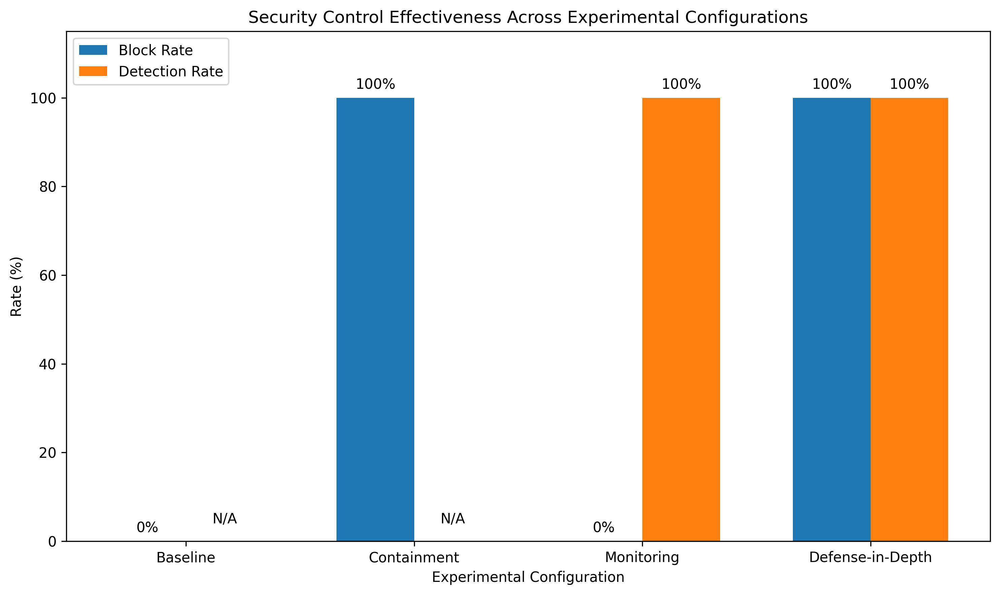

# AI Agent Network Containment and Monitoring Testbed

**A Docker-based cybersecurity research project evaluating network containment, traffic monitoring, and defense-in-depth security controls for controlled agent-like network communication.**

## Project Overview

This project evaluates the effectiveness of network-level containment and monitoring controls in an isolated Docker environment.

The primary objective is to determine whether unauthorized network communication can be prevented and detected while maintaining access to authorized network resources.

Four security configurations were evaluated:

1. **Baseline:** No containment or dedicated packet monitoring.
2. **Containment:** Firewall-based traffic restriction without dedicated monitoring.
3. **Monitoring:** Network traffic monitoring without containment.
4. **Defense-in-Depth:** Firewall containment and packet monitoring operating together.

The experiment uses a scripted, controlled agent-like workload to ensure consistent and repeatable network communication across all configurations.

## Key Findings

The completed formal experiment included **40 trials and 80 communication observations**.

- **100% restricted-traffic blocking** when containment was enabled.
- **100% restricted-traffic detection** when monitoring was enabled.
- **100% authorized communication success** across all four configurations.
- **100% monitoring-log coverage** in monitoring-enabled configurations.
- **63.04 ms mean monitoring observation latency** in the supplemental latency experiment.
- **Zero observed false positives** across 10 authorized-only supplemental trials.

These results apply to the controlled experimental environment and should not be generalized to all autonomous AI agent deployments.

## Technologies Used

- Docker Desktop and Docker Compose
- Alpine Linux
- Linux `iptables`
- `tcpdump`
- Bash scripting
- `curl`
- Nginx
- Linux networking and routing

**Development environment:** MacBook Air with Apple M4.

## Testbed Architecture

The environment consists of four Docker containers connected through two isolated bridge networks.

| Component | IP Address | Purpose |
|---|---|---|
| Agent | `10.10.1.2` | Generates controlled network requests |
| Security Gateway | `10.10.1.3` / `10.10.2.4` | Routes, filters, and monitors traffic |
| Approved Server | `10.10.2.2` | Authorized communication destination |
| Restricted Server | `10.10.2.3` | Restricted communication destination |

### Docker Networks

- **Agent Network:** `10.10.1.0/24`
- **Protected Server Network:** `10.10.2.0/24`

The agent communicates with the protected network through the security gateway.

When containment is enabled, the gateway applies an `iptables` rule that drops traffic from `10.10.1.2` to the restricted server at `10.10.2.3`.

## Experimental Methodology

The project compares four security configurations.

| Configuration | Firewall Containment | Packet Monitoring |
|---|---|---|
| Baseline | Disabled | Disabled |
| Containment | Enabled | Disabled |
| Monitoring | Disabled | Enabled |
| Defense-in-Depth | Enabled | Enabled |

Each trial includes:

1. An authorized HTTP request to `10.10.2.2`.
2. A restricted HTTP request to `10.10.2.3`.
3. Observation of communication success or failure.
4. Collection of applicable firewall and monitoring evidence.

Ten trials were conducted for each configuration, resulting in 40 trials and 80 communication observations.

## Formal Experimental Results

| Configuration | Restricted Block Rate | Detection Rate | Authorized Success |
|---|---:|---:|---:|
| Baseline | 0% | N/A | 100% |
| Containment | 100% | N/A | 100% |
| Monitoring | 0% | 100% | 100% |
| Defense-in-Depth | 100% | 100% | 100% |

Detection is marked N/A where dedicated packet monitoring was disabled.

### Security Control Comparison



The visualization compares restricted-traffic blocking and detection rates across the four configurations.

**Formal dataset:** `results/experiments/formal-results-final.csv`

This dataset contains the completed formal results reported in the research paper and should be preserved without modification.

## Monitoring and Firewall Evidence

### Network Monitoring

`tcpdump` was used to capture traffic involving the restricted destination.

Monitoring evidence was preserved for:

- Monitoring: 10/10 trials
- Defense-in-Depth: 10/10 trials

Both monitoring-enabled configurations achieved 100% logging coverage.

### Firewall Verification

The security gateway uses Linux `iptables` to restrict communication with the protected destination.

The configured rule specifies:

- **Source:** `10.10.1.2`
- **Destination:** `10.10.2.3`
- **Action:** `DROP`

Saved firewall evidence confirmed matching dropped packets in all 10 containment trials and all 10 defense-in-depth trials.

Supporting evidence is stored under `results/experiments/`.

## Supplemental Experiments

### Monitoring Observation Latency

A supplemental 10-trial experiment measured the time between the recorded test start and first observed packet.

| Metric | Result |
|---|---:|
| Mean | 63.04 ms |
| Median | 64.04 ms |
| Minimum | 51.53 ms |
| Maximum | 72.27 ms |
| Sample Standard Deviation | 5.19 ms |

**Dataset:** `results/latency/raw-results.csv`

These measurements represent packet-monitoring observation latency under the test conditions, not full intrusion detection system alert-processing latency.

### False-Positive Evaluation

A separate 10-trial experiment evaluated the destination-based monitoring method using authorized-only traffic.

| Metric | Result |
|---|---:|
| Authorized Traffic Observed | 10/10 |
| Authorized Requests Successful | 10/10 |
| Restricted Destination Detected | 0/10 |
| Observed False Positives | 0/10 |

**Dataset:** `results/false-positive/false-positive-results.csv`

These findings are limited to the controlled destination-based detection method used in this experiment.

## How to Run the Project

### Prerequisites

Install Docker Desktop with Docker Compose support. Docker Desktop must be running before starting the environment.

### 1. Start the Containers

From the project directory:

```bash
docker compose up -d
```

Verify the containers:

```bash
docker ps
```

Expected containers:

- `agent`
- `security-gateway`
- `approved-server`
- `restricted-server`

### 2. Verify Network Routing

```bash
docker exec agent ip route
```

The route to `10.10.2.0/24` should use the gateway at `10.10.1.3`.

### 3. Select a Security Configuration

**Baseline:**

```bash
./set-configuration.sh baseline
```

**Containment:**

```bash
./set-configuration.sh containment
```

**Monitoring:**

```bash
./set-configuration.sh monitoring
```

**Defense-in-Depth:**

```bash
./set-configuration.sh defense-in-depth
```

### 4. Execute the Controlled Workload

```bash
docker exec agent /run-workload.sh
```

The workload performs an authorized HTTP request and a restricted HTTP request.

### 5. Run an Individual Experiment

```bash
./run-experiment.sh baseline 1
```

Other examples:

```bash
./run-experiment.sh containment 1
./run-experiment.sh monitoring 1
./run-experiment.sh defense-in-depth 1
```

### 6. Run the Formal Experiment

```bash
./run-formal-experiments.sh
```

**Important:** Preserve `results/experiments/formal-results-final.csv` as the frozen research dataset. Do not overwrite it during reproduction.

### 7. Verify Firewall Rules

```bash
docker exec security-gateway iptables -L FORWARD -n -v --line-numbers
```

### 8. Run Supplemental Experiments

Monitoring observation latency:

```bash
./run-latency-experiment.sh
```

False-positive evaluation:

```bash
./run-false-positive-experiment.sh
```

### 9. Stop the Environment

```bash
docker compose down
```

## Skills Demonstrated

- **Network Security:** Network segmentation, routing, and firewall-based containment.
- **Network Traffic Analysis:** Packet monitoring and evidence collection using `tcpdump`.
- **Containerization:** Building isolated test environments using Docker Compose.
- **Linux Security:** Configuring and validating `iptables` firewall rules.
- **Security Testing:** Evaluating containment, monitoring, and defense-in-depth configurations.
- **Security Metrics:** Measuring blocking rates, detection rates, authorized communication success, observation latency, and false positives.
- **Bash Automation:** Automating configuration changes and repeatable experiments.
- **Cybersecurity Research:** Designing controlled experiments, collecting evidence, analyzing results, and documenting limitations.

## Reproducibility and Limitations

The project uses fixed container IP addresses, scripted configuration changes, repeatable network requests, and recorded experimental evidence to support reproducibility.

The formal results were generated using the project scripts in a local Docker test environment.

**Important limitation:** This project evaluates a controlled agent-like network workload rather than implementing a complete autonomous AI agent. The experimental findings demonstrate the behavior of the tested network security controls within this isolated environment.

## Project Context

Developed as a graduate-level Network Security research project focused on evaluating containment and monitoring controls for agent-like network communication in cybersecurity evaluation environments.
